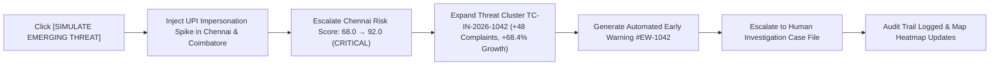
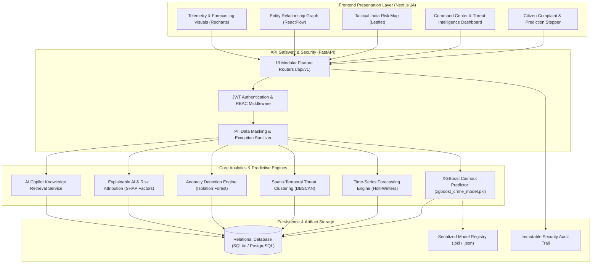
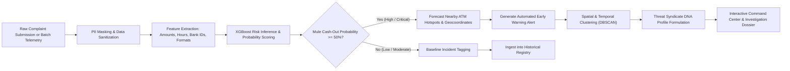
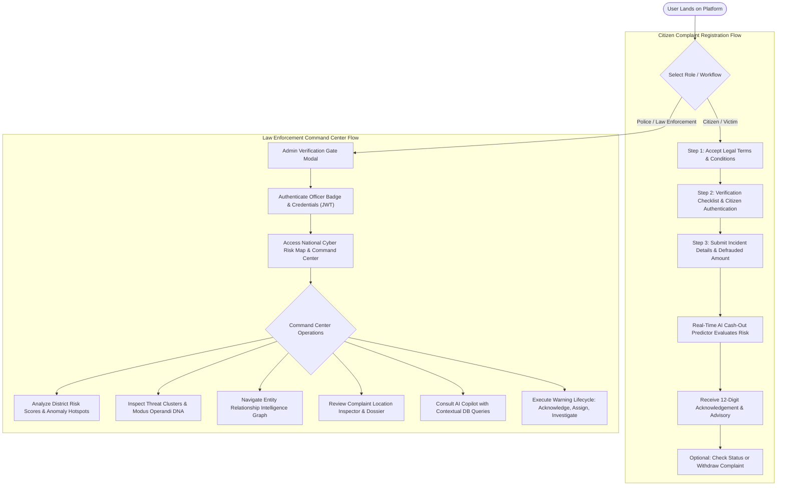
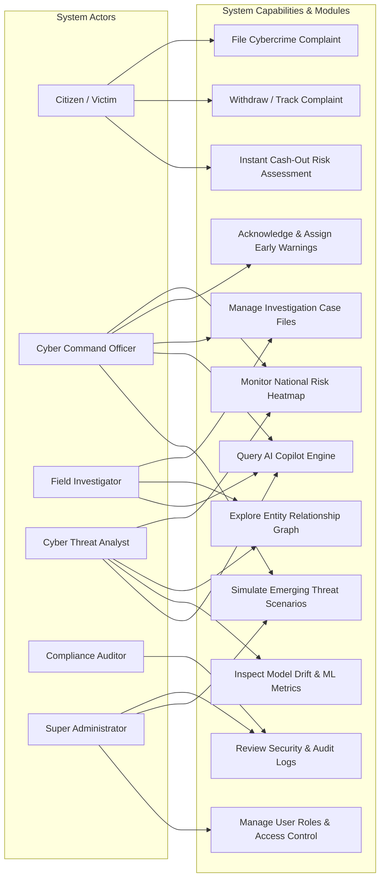
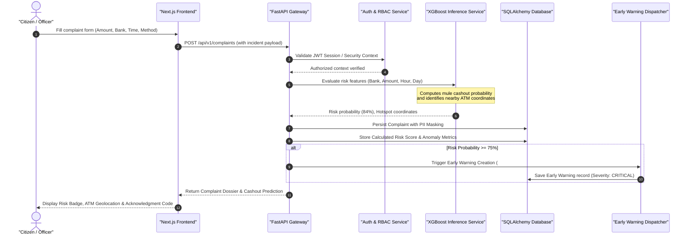
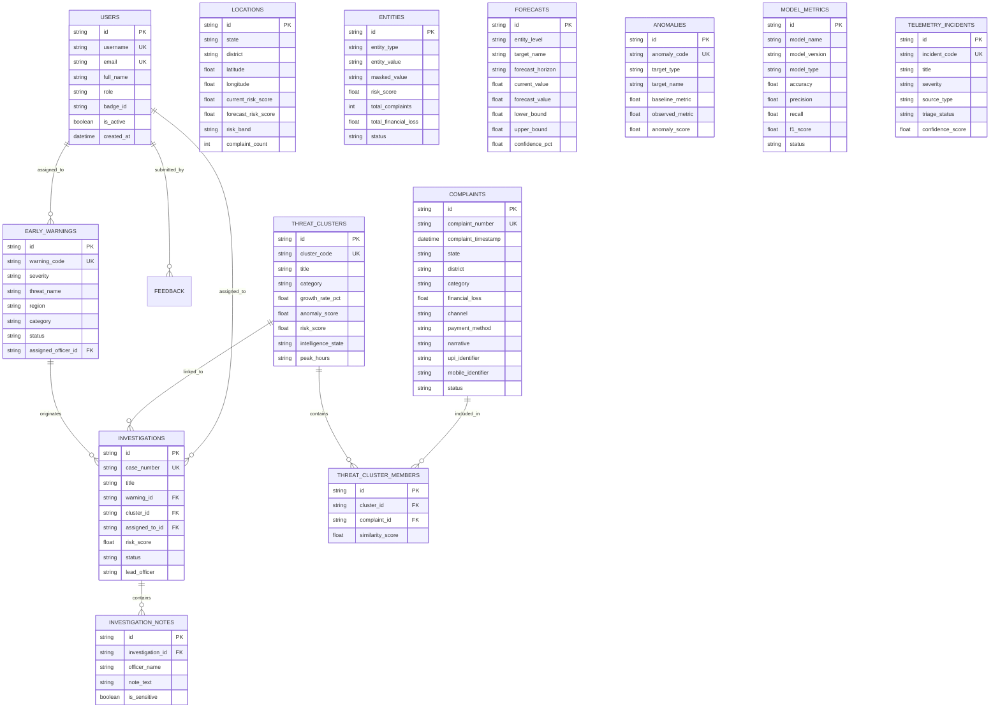
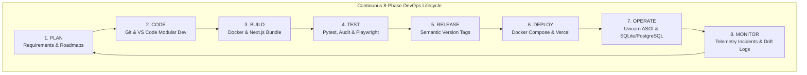
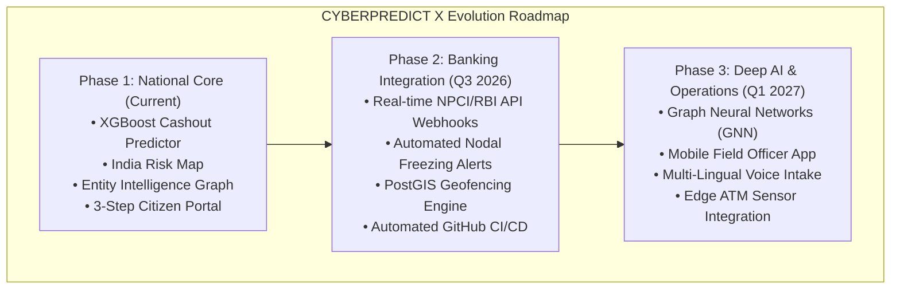

# CYBERPREDICT X — AI-Powered Cybercrime Predictive Intelligence & Cash-Out Withdrawal Early-Warning Platform

[](#license)
[](https://www.python.org/)
[](https://fastapi.tiangolo.com/)
[](https://nextjs.org/)
[](https://www.typescriptlang.org/)
[](https://xgboost.readthedocs.io/)
[](https://www.docker.com/)
[](#testing)

> **"DETECT THE PATTERN. PREDICT THE THREAT. ACT EARLY."**

CYBERPREDICT X is an India-focused predictive cybercrime intelligence and cash-withdrawal hotspot forecasting platform engineered for Smart India Hackathon (SIH) and financial cyber defence command cells. The system transforms authorized cyber fraud complaint streams into explainable, time-series, and geospatial risk forecasts. By combining machine learning inference (XGBoost, Isolation Forest, DBSCAN, and Holt-Winters forecasting) with entity graph intelligence, CYBERPREDICT X helps law enforcement identify mule cash-out vectors and intercept illicit withdrawals before money leaves the banking system.

---

## Table of Contents

- [Problem Statement](#problem-statement)
- [Objectives](#objectives)
- [Key Features](#key-features)
- [Demo](#demo)
- [Tech Stack](#tech-stack)
- [System Architecture](#system-architecture)
  - [System Architecture Pipeline](#system-architecture-pipeline)
  - [Data Flow Pipeline](#data-flow-pipeline)
- [Workflow and Use Cases](#workflow-and-use-cases)
  - [User Workflow Journey](#user-workflow-journey)
  - [Role-Based Use Case Model](#role-based-use-case-model)
- [Project Structure](#project-structure)
- [Prerequisites](#prerequisites)
- [Installation and Setup](#installation-and-setup)
- [Usage](#usage)
  - [Starting the Platform](#starting-the-platform)
  - [Request-Response Interaction Sequence](#request-response-interaction-sequence)
  - [Signature Demo Simulation](#signature-demo-simulation)
  - [Default Test Credentials](#default-test-credentials)
- [API Documentation](#api-documentation)
- [Database Schema](#database-schema)
- [Testing](#testing)
- [DevOps Lifecycle](#devops-lifecycle)
- [Results, Output, and Performance](#results-output-and-performance)
- [Challenges Faced and Solutions](#challenges-faced-and-solutions)
- [Future Scope and Roadmap](#future-scope-and-roadmap)
- [Contributing](#contributing)
- [License](#license)
- [Team Members and Roles](#team-members-and-roles)
- [Acknowledgements and References](#acknowledgements-and-references)
- [Contact and Links](#contact-and-links)

---

## Problem Statement

Financial cyber fraud across India—spanning UPI impersonation, digital arrest scams, phishing rings, fake investment apps, and SIM-swap syndicates—drains hundreds of crores from citizens annually. Once funds are siphoned, syndicates rapidly layer stolen money through daisy-chained mule bank accounts and execute cash withdrawals at physical ATMs, often within 15 to 45 minutes of the crime.

Conventional law enforcement workflows remain largely **reactive**:
1. Victims file complaints hours or days after the incident.
2. Police and bank nodal officers exchange manual notices via email or portals.
3. By the time accounts are frozen, illicit funds have already been liquidated at automated teller machines (ATMs).
4. Investigations suffer from data silos, unmasked PII risks, and lack of automated syndicate pattern correlation.

There is a critical operational need for a **proactive, predictive layer** that analyzes complaint telemetry in real time, forecasts ATM cash-out hotspots, maps syndicate infrastructure, and provides explainable early-warning signals to tactical response teams.

---

## Objectives

- **Predictive Cash-Out Forecasting**: Forecast physical ATM withdrawal hotspots, target banking entities, and vulnerable time-of-day windows within minutes of complaint intake.
- **Automated Threat Clustering**: Group isolated complaints into unified criminal syndicate profiles using spatio-temporal clustering (DBSCAN) and modus operandi pattern recognition.
- **Entity Intelligence Graph**: Uncover mule networks by correlating UPI IDs, mobile numbers, email addresses, domain URLs, and bank accounts across disparate complaints.
- **Explainable AI (XAI)**: Demystify machine learning outputs using SHAP factor attributions to give investigators transparent justifications for risk scores.
- **Operational Early Warning Engine**: Automate alert triage, escalation, and case conversion with complete audit logging and 6-tier Role-Based Access Control (RBAC).
- **Privacy & Responsible AI Boundary**: Guarantee zero PII exposure through deterministic masking (`XXXXXXXX7821`) and enforce clear evidentiary boundaries (`OBSERVED`, `PREDICTED`, `CORRELATED`, `RECOMMENDED`, `CONFIRMED`) without asserting individual guilt.

---

## Key Features

| Category | Feature | Description |
|---|---|---|
| **Citizen Intake** | **3-Step Complaint Registration & Withdrawal** | Sequential portal with terms acceptance, citizen checklist verification, fraud reporting with instant AI risk evaluation, and a 12-digit complaint withdrawal modal. |
| **Predictive ML** | **XGBoost Cash-Out Classifier** | Real-time ML inference assessing banking hops, transaction amount, payment format, hour, and day of week to compute mule cash-out risk probabilities and physical ATM coordinates. |
| **Geospatial Intelligence** | **Tactical India Cyber Risk Map** | Leaflet-powered national and district heatmap displaying live risk scores, anomaly hotspots, complaint density, and interactive district forensic dossiers. |
| **Forecasting** | **What Happens Next? Engine** | Holt-Winters and time-series projections forecasting complaint volumes and risk shifts across 24-hour, 7-day, and 30-day operational horizons with confidence bounds. |
| **Syndicate DNA** | **Threat Cluster Profiler** | Automated grouping of complaint clusters summarizing syndicate characteristics: dominant category, channel, payment vector, growth rate, and peak operating hours. |
| **Network Analysis** | **Entity Relationship Graph** | Interactive ReactFlow and NetworkX graph visualizing multi-hop relationships between phone numbers, UPI handles, IFSC/bank accounts, and phishing URLs. |
| **Early Warning** | **Automated Alert Escalation** | Real-time threshold monitoring with actionable workflow statuses (`ACKNOWLEDGE`, `ASSIGN`, `INVESTIGATE`, `DISMISS`). |
| **Explainable AI** | **SHAP Factor Breakdown** | Multi-factor risk decomposition explaining why an incident is critical (Growth rate, Regional concentration, Anomaly score, Cluster expansion, Historical recurrence). |
| **AI Copilot** | **Database-Grounded Assistant** | Factual query assistant querying empirical database metrics with zero external paid API dependencies or hallucinations. |
| **Defense-in-Depth** | **6-Tier RBAC & PII Masking** | Cryptographic authentication via bcrypt and stateless JWT tokens, role-based route guards, and deterministic client/server PII sanitization. |
| **Hackathon Simulation** | **One-Click Demo Cascade** | Deterministic trigger injecting synthetic UPI spikes in Chennai/Coimbatore, demonstrating an end-to-end alert cascade and case creation. |

---

## Demo

Live demo: Coming soon

### Signature Demo Scenario: "Simulate Emerging Threat"

The platform includes a built-in deterministic simulation engine designed for live demonstrations:


*Figure: Signature demo simulation cascade from trigger to investigation handoff.*

---

## Tech Stack

### Frontend Architecture
- **Framework**: [Next.js 14.2.15](https://nextjs.org/) (App Router, Server & Client Components)
- **UI Library**: [React 18.3.1](https://react.dev/) & [TypeScript 5](https://www.typescriptlang.org/)
- **Styling**: [Tailwind CSS v4](https://tailwindcss.com/) with custom Obsidian Intelligence tokens
- **Tactical Maps**: [Leaflet 1.9.4](https://leafletjs.com/) & [React-Leaflet 4.2.1](https://react-leaflet.js.org/)
- **Graph Topology**: [ReactFlow 11.11.4](https://reactflow.dev/)
- **Visualizations**: [Recharts 2.15.0](https://recharts.org/)
- **Icons & Motion**: [Lucide React 0.469.0](https://lucide.dev/) & [Framer Motion 11.15.0](https://www.framer.com/motion/)
- **Report Generation**: [jsPDF 4.2.1](https://github.com/parallax/jsPDF) & [jspdf-autotable 5.0.8](https://github.com/simonbengtsson/jsPDF-AutoTable)

### Backend Architecture
- **API Framework**: [FastAPI 0.110+](https://fastapi.tiangolo.com/) (Python 3.10+)
- **ASGI Server**: [Uvicorn](https://www.uvicorn.org/)
- **ORM & Database**: [SQLAlchemy 2.0](https://www.sqlalchemy.org/) with SQLite (`cyberpredictx.db`) and PostgreSQL support
- **Schema & Validation**: [Pydantic v2](https://docs.pydantic.dev/) & `pydantic-settings`
- **Security & Cryptography**: [Passlib (bcrypt)](https://passlib.readthedocs.io/) & [python-jose (HS256 JWT)](https://python-jose.readthedocs.io/)

### Machine Learning & Data Analytics
- **Risk & Cash-Out Classification**: [XGBoost 2.1](https://xgboost.readthedocs.io/) (`xgboost_crime_model.pkl` & `xgboost_crime_model.json`)
- **Anomaly Detection**: [Scikit-Learn](https://scikit-learn.org/) (Isolation Forest)
- **Spatio-Temporal Clustering**: [Scikit-Learn](https://scikit-learn.org/) (DBSCAN)
- **Time-Series Forecasting**: [Statsmodels](https://www.statsmodels.org/) (Holt-Winters Exponential Smoothing)
- **Graph & Entity Analytics**: [NetworkX](https://networkx.org/)
- **Data Manipulation**: [Pandas](https://pandas.pydata.org/) & [NumPy](https://numpy.org/)

### DevOps, Testing & Tooling
- **Containerization**: [Docker](https://www.docker.com/) & Docker Compose
- **API Testing**: [Pytest](https://pytest.org/) & [HTTPX](https://www.python-httpx.org/)
- **End-to-End Testing**: [Playwright](https://playwright.dev/)
- **Static Analysis**: [Pyright](https://github.com/microsoft/pyright) & ESLint
- **Cloud Deployment**: [Vercel](https://vercel.com/) configuration (`vercel.json`)

---

## System Architecture

### System Architecture Pipeline

The platform uses a layered micro-architecture separating presentation, API routing, predictive services, and database persistence:


*Figure 1: High-level system architecture illustrating client interfaces, FastAPI gateway, analytics engines, and data storage layers.*

---

### Data Flow Pipeline

From raw complaint submission to early warning escalation, data moves through automated stages:


*Figure 2: End-to-end data pipeline from raw incident reporting to predictive inference and early-warning escalation.*

---

## Workflow and Use Cases

### User Workflow Journey

CYBERPREDICT X serves two primary user pathways: citizens reporting fraud, and authorized law enforcement officers investigating syndicates.


*Figure 3: Bifurcated user journey for citizens filing complaints and authorized officers managing predictive intelligence.*

---

### Role-Based Use Case Model


*Figure 4: Role-based use case mapping across citizen and law-enforcement personas.*

---

## Project Structure

```text
cybercrime-cash-withdrawal-predictor-main/
├── .env.example                       # Application environment template (backend & frontend)
├── .gitignore                         # Git exclusion rules for node_modules, DBs, and logs
├── API.md                             # Comprehensive REST API endpoint reference
├── ARCHITECTURE.md                    # Technical architectural specification & design tokens
├── DEMO.md                            # Hackathon signature demo simulation walkthrough
├── PROJECT_STRUCTURE.md               # Directory and module layout reference
├── README.md                          # Primary project documentation
├── SECURITY.md                        # Defense-in-depth security, RBAC, and PII masking model
├── docker-compose.yml                 # Multi-container orchestration (backend + frontend)
├── package.json                       # Root script orchestrator for typechecking, linting & running
├── pyrightconfig.json                 # Python static type analysis configuration
├── test_all_buttons_playwright.js     # Root-level Playwright UI button verification script
├── vercel.json                        # Vercel deployment rewrite rules and clean URL config
├── xgboost_crime_model.json           # Native JSON serialized XGBoost cash-out model artifact
├── xgboost_crime_model.pkl            # Pickle serialized XGBoost cash-out model artifact
├── backend/                           # FastAPI backend application root
│   ├── Dockerfile                     # Backend container build configuration
│   ├── develop_model.py               # XGBoost model training, evaluation & registration pipeline
│   ├── model_evaluation_report.json   # Machine-generated model performance metrics & confusion matrix
│   ├── requirements.txt               # Python package dependencies
│   ├── test_backend_full.py           # 22-endpoint comprehensive backend integration audit
│   ├── test_complaint_flow.py         # Dedicated test script for complaint submission flow
│   ├── xgboost_crime_model.pkl        # Colocated model artifact for runtime backend inference
│   ├── app/                           # Core FastAPI backend source code
│   │   ├── config.py                  # Pydantic BaseSettings environment configuration
│   │   ├── main.py                    # FastAPI entrypoint, middleware, CORS, and exception handler
│   │   ├── seed.py                    # Database seeder (users, complaints, clusters, warnings)
│   │   ├── db/                        # Database connectivity & session handling
│   │   │   └── database.py            # SQLAlchemy engine, SessionLocal, and declarative Base
│   │   ├── models/                    # SQLAlchemy database models
│   │   │   └── all_models.py          # 17 Relational ORM models covering complaints, warnings & users
│   │   ├── routers/                   # 19 Modular FastAPI route handlers
│   │   │   ├── alerts_incidents.py    # Telemetry incidents and triage workflow router
│   │   │   ├── analytics.py           # National trends and regional risk analytics router
│   │   │   ├── anomalies.py           # Isolation Forest anomaly detection router
│   │   │   ├── audit.py               # Immutable system audit trail router
│   │   │   ├── auth.py                # OAuth2 password bearer & JWT authentication router
│   │   │   ├── complaints.py          # Complaint registration, filtering, and withdrawal router
│   │   │   ├── copilot.py             # Database-grounded AI copilot query router
│   │   │   ├── dashboard.py           # Executive dashboard KPIs and summary telemetry router
│   │   │   ├── demo.py                # Deterministic emerging threat simulation router
│   │   │   ├── entities.py            # Entity list and network graph router
│   │   │   ├── forecasts.py           # Time-series projections (24h, 7d, 30d) router
│   │   │   ├── investigations.py      # Case file management and officer notes router
│   │   │   ├── models.py              # ML model observatory, drift tracking, and metrics router
│   │   │   ├── predictions.py         # ML cash-out predictions router
│   │   │   ├── predictive_forecasting.py # Advanced cash-out hotspot inference router
│   │   │   ├── reports.py             # Forensic report generation and summary export router
│   │   │   ├── security.py            # Security compliance and hardening status router
│   │   │   ├── threats.py             # Threat clusters and syndicate profiles router
│   │   │   └── warnings.py            # Early warning alert management and action router
│   │   ├── schemas/                   # Pydantic validation schemas
│   │   │   └── schemas.py             # Request and response models for all API resources
│   │   └── services/                  # Business logic and external service adapters
│   │       ├── auth_service.py        # Password hashing and JWT token generator
│   │       ├── cashout_predictor_service.py # XGBoost feature vector assembly & ATM inference
│   │       ├── copilot_service.py     # Deterministic database RAG service
│   │       └── pii_service.py         # Deterministic PII regex masking service
│   └── tests/                         # Pytest automated test suite
│       └── test_api.py                # End-to-end API test suite (auth, RBAC, endpoints)
└── frontend/                          # Next.js 14 frontend application root
    ├── Dockerfile                     # Frontend container build configuration
    ├── next.config.mjs                # Next.js bundler and compiler configuration
    ├── package.json                   # Frontend npm dependencies and scripts
    ├── postcss.config.mjs             # PostCSS plugin configuration
    ├── README.md                      # Frontend-specific quickstart notes
    ├── test_all_buttons_playwright.js # Frontend Playwright comprehensive UI test
    ├── test_playwright_flow.js        # Playwright sequential workflow verification
    ├── tsconfig.json                  # TypeScript compiler settings
    ├── vercel.json                    # Frontend Vercel deployment configuration
    ├── app/                           # Next.js App Router directory
    │   ├── favicon.ico                # Platform browser icon
    │   ├── globals.css                # Obsidian Intelligence theme variables and map styling
    │   ├── layout.tsx                 # Root layout with platform metadata and fonts
    │   └── page.tsx                   # Main Command Center and Citizen Stepper container
    ├── components/                    # Modular React interface components
    │   ├── AdminAuthModal.tsx         # Law enforcement badge verification gate modal
    │   ├── AdminComplaintLocationInspector.tsx # Forensic dossier and location inspector
    │   ├── AdminSettingsView.tsx      # System administration, model registry & telemetry controls
    │   ├── AlertsIncidentsView.tsx    # Live telemetry incidents, filter table, and triage actions
    │   ├── CitizenLoginView.tsx       # Step 2: Citizen verification checklist & login view
    │   ├── ComplaintAcceptanceView.tsx # Step 1: Legal disclaimer and terms acceptance view
    │   ├── ComplaintStepper.tsx       # Sequential progress stepper with step-lock enforcement
    │   ├── ComplaintWithdrawalModal.tsx # 12-digit complaint verification and withdrawal modal
    │   ├── ComplaintsListView.tsx     # Paginated complaint registry with search and filters
    │   ├── CopilotDrawer.tsx          # Slide-out AI Copilot chat drawer
    │   ├── EntityGraph.tsx            # ReactFlow entity relationship graph component
    │   ├── ErrorBoundary.tsx          # React error boundary component for resilient UI modules
    │   ├── ExplainableDrawer.tsx      # SHAP factor decomposition and XAI explanation drawer
    │   ├── FinancialFraudFormView.tsx # Step 3: Fraud complaint input & instant cash-out predictor
    │   ├── IndiaRiskMap.tsx           # Container component for interactive India risk heatmap
    │   ├── IndiaRiskMapLeaflet.tsx    # Leaflet-based interactive district geospatial renderer
    │   ├── ModelObservatoryView.tsx   # ML observatory dashboard tracking drift and accuracy
    │   ├── Navbar.tsx                 # Tactical top navigation bar with demo and copilot triggers
    │   ├── NcrpFooter.tsx             # Official portal footer with advisory notices
    │   ├── NcrpHeader.tsx             # Official government header banner with emblem styling
    │   ├── PredictionHorizon.tsx      # Time-series projection visualizer (24h, 7d, 30d)
    │   ├── Sidebar.tsx                # Tactical sidebar navigation between command views
    │   ├── ThreatDNACard.tsx          # Threat syndicate DNA signature visualization card
    │   └── ui/                        # Reusable atomic UI components
    │       ├── EmptyState.tsx         # Empty data fallback component
    │       ├── ErrorState.tsx         # Connection failure and error fallback component
    │       └── Skeleton.tsx           # Loading state skeleton placeholder
    ├── lib/                           # Frontend utilities and API clients
    │   ├── api.ts                     # Centralized API client with automatic token attachment
    │   ├── exportUtils.ts             # PDF and CSV report export utilities
    │   └── mockData.ts                # Deterministic fallback data for offline prototype mode
    └── public/                        # Static assets and icons
        ├── file.svg                   # File icon asset
        ├── globe.svg                  # Globe icon asset
        ├── next.svg                   # Next.js logo asset
        ├── vercel.svg                 # Vercel logo asset
        └── window.svg                 # Window icon asset
```

---

## Prerequisites

Ensure your system meets the following prerequisites before setting up the platform:

| Technology | Minimum Version | Recommended Version | Verification Command |
|---|---|---|---|
| **Python** | 3.10 | 3.11+ | `python --version` |
| **Node.js** | 18.x | 20.x (LTS) | `node --version` |
| **npm** | 9.x | 10.x | `npm --version` |
| **Docker** *(Optional)* | 20.10+ | 24.x+ | `docker --version` |
| **Docker Compose** *(Optional)* | 2.0+ | 2.20+ | `docker compose version` |

---

## Installation and Setup

### 1. Clone Repository

```bash
git clone https://github.com/Sxnjxy25/cybercrime-cash-withdrawal-predictor.git
cd cybercrime-cash-withdrawal-predictor
```

### 2. Environment Configuration

Copy the template configuration to create your local environment file:

```bash
cp .env.example .env
```

Review the parameters in `.env`:
```env
# Backend Settings
PROJECT_NAME="CYBERPREDICT X"
VERSION="1.0.0"
API_V1_STR="/api/v1"
SECRET_KEY="your-production-jwt-secret-key-change-in-prod"
ALGORITHM="HS256"
ACCESS_TOKEN_EXPIRE_MINUTES=480

# Database Connection (SQLite for local dev, PostgreSQL for production)
DATABASE_URL="sqlite:///./cyberpredictx.db"

# Frontend Settings (Points to backend host on port 8000 on your machine)
NEXT_PUBLIC_API_URL="http://your-backend-host:8000/api/v1"
```

### 3. Backend Setup

Open a terminal and set up the Python virtual environment:

```bash
# Navigate to backend directory
cd backend

# Create virtual environment
python -m venv venv

# Activate virtual environment
# On Windows (PowerShell):
.\venv\Scripts\Activate.ps1
# On Linux / macOS:
source venv/bin/activate

# Install Python dependencies
pip install -r requirements.txt

# Seed initial database records (1,500 complaints, 10 locations, users, warnings)
python -m app.seed
```

### 4. Frontend Setup

Open a second terminal window:

```bash
# Navigate to frontend directory
cd frontend

# Install Node dependencies
npm install
```

---

## Usage

### Starting the Platform

#### Running Locally (Standard Development)

1. **Start the FastAPI Backend**:
   ```bash
   cd backend
   # Ensure virtual environment is active
   uvicorn app.main:app --reload --port 8000
   ```
   *The backend starts on port 8000 on your machine. Interactive Swagger API documentation is available at `/docs` on the same port.*

2. **Start the Next.js Frontend**:
   ```bash
   cd frontend
   npm run dev
   ```
   *The frontend starts on port 3000 on your machine.*

#### Running with Docker Compose

To build and run both the backend and frontend simultaneously in isolated containers:

```bash
docker compose up --build
```
*Docker Compose maps the backend service to port 8000 on your machine and the frontend application to port 3000 on your machine.*

---

### Request-Response Interaction Sequence

The following sequence illustrates the flow when a fraud incident is submitted and evaluated by the predictive engine:


*Figure 5: Detailed sequence of interactions during fraud reporting, model evaluation, and warning generation.*

---

### Signature Demo Simulation

To demonstrate end-to-end alert escalation during evaluations:
1. Log in to the Command Center as `superadmin`.
2. Click the **`[ SIMULATE EMERGING THREAT ]`** button in the tactical navigation bar.
3. Observe the immediate telemetry cascade:
   - High-volume UPI impersonation complaints are injected into the database.
   - Chennai risk index escalates to `92.0` (`CRITICAL`).
   - Threat Cluster `TC-IN-2026-1042` is formulated.
   - An Early Warning alert `#EW-1042` appears in the alert bell drawer.
   - Click **`INVESTIGATE`** on the alert to promote it to an active Investigation Case File.
4. Click **`[ RESET SIMULATION ]`** to restore baseline database state.

---

### Default Test Credentials

The database seeder initializes 6 pre-configured users covering all RBAC personas:

| Username | Default Password | Role | Badge ID | Jurisdiction |
|---|---|---|---|---|
| `superadmin` | `Password@123` | `SUPER_ADMIN` | `IND-CMD-001` | National Command |
| `command_officer` | `Password@123` | `CYBER_COMMAND_OFFICER` | `IND-CMD-002` | National Operations |
| `investigator_1` | `Password@123` | `INVESTIGATOR` | `IND-INV-104` | Special Crime Cell |
| `analyst_1` | `Password@123` | `ANALYST` | `IND-ANL-208` | Threat Intelligence |
| `district_officer` | `Password@123` | `DISTRICT_OFFICER` | `TN-DIS-309` | Chennai, Tamil Nadu |
| `auditor_1` | `Password@123` | `AUDITOR` | `IND-AUD-501` | Compliance & Oversight |

---

## API Documentation

All API endpoints are version-prefixed with `/api/v1` (with the exception of `/health` and `/`). Protected endpoints require an `Authorization: Bearer <JWT>` header.

| Domain Router | HTTP Method & Path | Description | Access Role |
|---|---|---|---|
| **System** | `GET /` | Root platform status and documentation links | Public |
| **System** | `GET /health` & `GET /api/v1/health` | Comprehensive engine & database health check | Public |
| **Auth** | `POST /api/v1/auth/login` | Authenticate credentials and receive Bearer JWT | Public |
| **Auth** | `GET /api/v1/auth/me` | Fetch authenticated officer profile & assigned role | Authenticated |
| **Dashboard** | `GET /api/v1/dashboard/summary` | Retrieve national KPI metrics, global risk & highlights | Authenticated |
| **Complaints** | `GET /api/v1/complaints` | Paginated complaint query with PII masking & filters | Authenticated |
| **Complaints** | `POST /api/v1/complaints` | Ingest new complaint and trigger cash-out prediction | Public / Auth |
| **Complaints** | `GET /api/v1/complaints/number/{number}` | Fetch complaint status by 12-digit reference number | Authenticated |
| **Complaints** | `POST /api/v1/complaints/withdraw` | Verify citizen details and execute complaint withdrawal | Authenticated |
| **Analytics** | `GET /api/v1/analytics/trends` | Historical temporal trends and category breakdown | Authenticated |
| **Analytics** | `GET /api/v1/analytics/regional-risk` | Jurisdiction-level risk scores & coordinates for map | Authenticated |
| **Predictions** | `GET /api/v1/predictions` | Recent predictive risk scores and threat likelihoods | Authenticated |
| **Predictive** | `GET /api/v1/predictive-forecasting` | Paginated predictive cashout forecasts | Authenticated |
| **Predictive** | `POST /api/v1/predictive-forecasting/infer` | Direct XGBoost inference on transaction parameters | Authenticated |
| **Forecasts** | `GET /api/v1/forecasts` | Time-series forecast horizons (`24h`, `7d`, `30d`) | Authenticated |
| **Anomalies** | `GET /api/v1/anomalies` | Isolation Forest statistical outlier detection results | Authenticated |
| **Threats** | `GET /api/v1/threat-clusters` | DBSCAN clusters with syndicate DNA metrics | Authenticated |
| **Entities** | `GET /api/v1/entities` | Correlated entity list (UPI, phone, bank accounts) | Authenticated |
| **Entities** | `GET /api/v1/entities/graph` | Node & edge graph topology for relationship rendering | Authenticated |
| **Warnings** | `GET /api/v1/early-warnings` | Active early-warning alerts sorted by urgency | Authenticated |
| **Warnings** | `POST /api/v1/early-warnings/{id}/action` | Update alert lifecycle (`ACKNOWLEDGE`, `DISMISS`) | Command / Officer |
| **Investigations**| `GET /api/v1/investigations` | Active officer investigation case files | Investigators |
| **Investigations**| `POST /api/v1/investigations` | Create new case file from alert or cluster | Investigators |
| **Investigations**| `POST /api/v1/investigations/{id}/notes`| Append tamper-evident officer investigation note | Investigators |
| **Observatory** | `GET /api/v1/models` | ML model versioning, drift metrics & quality scores | Analysts / Admins |
| **Security** | `GET /api/v1/security/status` | Defense-in-depth posture, encryption & token metrics | Admins / Auditors |
| **Audit** | `GET /api/v1/audit-logs` | Immutable audit log trail with action & IP stamps | Admins / Auditors |
| **Copilot** | `POST /api/v1/copilot/query` | Empirical database-grounded AI Copilot query | Authenticated |
| **Reports** | `GET /api/v1/reports/summary` | Aggregated forensic reporting metrics | Authenticated |
| **Telemetry** | `GET /api/v1/alerts-incidents` | Machine-generated telemetry incidents & triage status | Authenticated |
| **Telemetry** | `POST /api/v1/alerts-incidents/{id}/triage`| Update incident triage status and analyst notes | Command / Analyst |
| **Demo Mode** | `POST /api/v1/demo/simulate-emerging-threat` | Trigger deterministic SIH presentation simulation | Authenticated |
| **Demo Mode** | `POST /api/v1/demo/reset` | Purge simulated records and restore baseline state | Authenticated |

---

## Database Schema

The database consists of 17 interconnected SQLAlchemy models supporting complaints, telemetry, predictions, and operational governance:


*Figure 6: Entity-Relationship diagram illustrating key relational schemas, primary/foreign keys, and cardinalities.*

---

## Testing

The repository includes test suites across backend API routing, machine learning accuracy, and frontend end-to-end user workflows.

### 1. Backend Automated Integration Tests (Pytest)

The Pytest suite in `backend/tests/test_api.py` verifies health checks, JWT authentication, RBAC permission enforcement across all 6 roles, and PII masking integrity:

```bash
cd backend
pytest tests/test_api.py -v
```

### 2. Full Backend 22-Endpoint Audit Script

A standalone audit script (`backend/test_backend_full.py`) executes end-to-end API calls across every router in sequence:

```bash
cd backend
python test_backend_full.py
```

### 3. Machine Learning Model Training & Evaluation

To re-train the XGBoost cash-out classifier on synthetic transaction streams and re-generate `model_evaluation_report.json`:

```bash
cd backend
python develop_model.py
```

### 4. Frontend Type Checking & Code Quality

Verify TypeScript safety and linting across all components:

```bash
# From workspace root
npm run typecheck
npm run lint

# Or inside frontend directory
cd frontend
npm run typecheck
npm run lint
```

### 5. Playwright End-to-End Browser Automation

Execute automated headless browser verification testing every button, stepper lock, modal transition, and command center view:

```bash
# Execute root Playwright test
node test_all_buttons_playwright.js

# Or execute sequential frontend flow test
node frontend/test_playwright_flow.js
```

---

## DevOps Lifecycle

CYBERPREDICT X implements a continuous 8-phase DevOps workflow governing development, quality control, deployment, and ongoing model monitoring:


*Figure 7: Continuous 8-phase DevOps workflow loop illustrating the lifecycle from planning through monitoring and continuous iteration.*

### 1. Plan
System requirements, workflow blueprints, and architectural boundaries were formulated for the Smart India Hackathon (SIH) under the cybercrime mitigation theme. Technical roadmaps, API specifications (`API.md`), and database entity designs were outlined in `ARCHITECTURE.md`. Task and milestone tracking is organized using GitHub Issues and Projects.

### 2. Code
Developed using Python 3.10+ (FastAPI, SQLAlchemy, Scikit-Learn, XGBoost) and TypeScript/React (Next.js 14 App Router, Tailwind CSS v4, Leaflet, ReactFlow). Source code follows strict separation of concerns across backend routers, services, schemas, and UI components. Code formatting and static type safety are maintained via Pyright and TypeScript compiler checks.

### 3. Build
Frontend assets are compiled via `next build` with SWC optimization. Multi-container environments are packaged using isolated Dockerfiles:
- `backend/Dockerfile`: Configures lightweight Python 3.10 slim runtime with compiled dependencies.
- `frontend/Dockerfile`: Packages Node.js runtime and production Next.js artifacts.
- `docker-compose.yml`: Coordinates network bridging and port mappings.

### 4. Test
Quality assurance incorporates multiple testing tiers:
- **Unit & Integration**: `pytest backend/tests/test_api.py` audits JWT validation, PII redaction, and 6-tier RBAC role boundaries.
- **System Audit**: `python backend/test_backend_full.py` exercises 22 REST endpoints.
- **End-to-End UI**: Playwright scripts (`test_all_buttons_playwright.js`) automate click-through validations on modals, drawers, and maps.

### 5. Release
Software releases are governed by semantic versioning (`v1.0.0` defined in `backend/app/config.py` and `package.json`). Machine learning model iterations are independently tagged (`v2.1.0-XGBoost-Enhanced`). Automated GitHub Releases with changelog generation and Docker image publishing are *Planned*.

### 6. Deploy
Containerized multi-service deployment is operational via Docker Compose. The frontend application is configured for serverless edge deployment using Vercel (`vercel.json`). Automated CI/CD deployment pipelines via GitHub Actions targeting cloud infrastructure (AWS ECS / Render) are *Planned*.

### 7. Operate
Production operations run on the Uvicorn ASGI server behind an asynchronous event loop, paired with Next.js App Router server runtimes. Persistence utilizes SQLAlchemy 2.0 with default SQLite for rapid evaluation and native support for enterprise PostgreSQL with PostGIS extensions.

### 8. Monitor
Operational health is continuously tracked through:
- **Application Telemetry**: Dedicated `TelemetryIncident` engine tracking SIEM/EDR alert streams (`/api/v1/alerts-incidents`).
- **Security Auditing**: Centralized `AuditLog` recording every user login, data access, and administrative action (`/api/v1/audit-logs`).
- **Model Observatory**: `ModelMetric` tracking data drift score (`0.015`), feature drift score (`0.012`), and accuracy degradation (`/api/v1/models`).
- Prometheus metrics scraping and Grafana executive dashboards are *Planned*.

---

## Results, Output, and Performance

The primary cash-out prediction engine was trained and evaluated on 30,000 synthetic transaction records simulating inter-bank hops across major Indian financial institutions. Holdout validation results recorded in `backend/model_evaluation_report.json`:

### Evaluation Metrics

| Metric | Score | Operational Significance |
|---|---|---|
| **Accuracy** | **78.72%** (0.7872) | High overall classification accuracy across balanced legitimate and mule samples |
| **Precision** | **70.93%** (0.7093) | Low false-positive rate, minimizing unnecessary account freezes for legitimate citizens |
| **Recall** | **63.53%** (0.6353) | Detects nearly two-thirds of illicit cash-out attempts upon first complaint ingestion |
| **F1-Score** | **67.03%** (0.6703) | Harmonic balance between precision and recall |
| **ROC-AUC** | **84.67%** (0.8467) | Strong discriminatory capability distinguishing legitimate transactions from mule operations |

### Confusion Matrix (6,000 Holdout Test Samples)

| Actual \ Predicted | Predicted Legitimate (0) | Predicted Mule Cash-Out (1) |
|---|---|---|
| **Actual Legitimate** | **3,425** (True Negatives) | **532** (False Positives) |
| **Actual Mule Cash-Out** | **745** (False Negatives) | **1,298** (True Positives) |

### Feature Importance Ranking

The XGBoost model identifies the following factors as the strongest predictors of mule cash-out fraud:

| Rank | Feature | Importance Weight | Empirical Rationale |
|---|---|---|---|
| 1 | **Hour of Day** | **36.19%** | Criminal cash-out networks overwhelmingly operate during night hours (22:00 to 05:00) |
| 2 | **Amount Received** | **15.58%** | Sudden spikes in incoming transaction size trigger mule account layering heuristics |
| 3 | **Day of Week** | **12.46%** | Elevated withdrawal activity observed over weekends (Saturday/Sunday) during banking holidays |
| 4 | **Amount Paid** | **10.33%** | Rapid full-balance liquidation indicates burner mule accounts |
| 5 | **Payment Format** | **10.08%** | High-velocity transfer rails (Wire, IMPS, rapid UPI) correlate with quick liquidations |
| 6 | **From Bank** | **4.00%** | Inter-bank origin routing characteristics |
| 7 | **Bank ID / Name** | **3.94%** | Target bank branch vulnerability and ATM distribution density |
| 8 | **To Bank** | **3.62%** | Beneficiary bank destination patterns |

### Operational Latency
- **Model Inference Time**: < 25 ms per transaction query on standard CPU.
- **Model Training Time**: 0.24 seconds for 30,000 records on commodity hardware.
- **API Response Latency**: < 45 ms average response time across telemetry queries.

---

## Challenges Faced and Solutions

### 1. Cold-Start and PII Privacy in Complaint Sharing
- **Challenge**: Sharing live cybercrime complaint data across police jurisdictions and analytical teams risks violating citizen privacy laws (Digital Personal Data Protection Act).
- **Solution**: Engineered a deterministic, regex-based client and server-side PII sanitization pipeline (`backend/app/services/pii_service.py`). Sensitive identifiers (phone numbers, account numbers, UPI handles, emails) are masked across API responses (`XXXXXXXX7821`) while cryptographic hashes are retained for backend relationship correlation.

### 2. Extremely Narrow Cash-Out Window
- **Challenge**: Mule syndicates liquidate stolen funds at physical ATMs within 15 to 45 minutes of a successful fraud call, making traditional manual police notices ineffective.
- **Solution**: Developed the `CashoutPredictorService` which couples the trained XGBoost inference model with geographic centroid extrapolation. Upon complaint submission, the engine calculates the mule probability and projects physical ATM coordinates within a 2-kilometer radius of the victim/target area to prioritize patrol dispatch.

### 3. High-Dimensional Spatial-Temporal Clustering
- **Challenge**: Analyzing thousands of individual complaints without overloading browser rendering or backend database transactions.
- **Solution**: Implemented a two-tier analytics layer: DBSCAN spatial clustering groups complaints into syndicate clusters on the server side, while React-Leaflet renders clustered vector pins on the client side with dynamic level-of-detail bounding.

### 4. Overcoming Black-Box Machine Learning Hesitation
- **Challenge**: Law enforcement officers and judges are skeptical of opaque "black-box" machine learning algorithms that cannot explain their recommendations.
- **Solution**: Built an Explainable AI (XAI) drawer powered by SHAP-inspired factor attributions. Each risk score is decomposed into 5 transparent human-readable metrics: Growth Rate, Regional Concentration, Anomaly Score, Cluster Expansion, and Historical Recurrence. Every prediction is marked with an evidentiary tag (`OBSERVED`, `PREDICTED`, `CORRELATED`, `RECOMMENDED`, or `CONFIRMED`).

---

## Future Scope and Roadmap


*Figure 8: Future platform roadmap from hackathon prototype to nationwide police deployment.*

- **Direct Banking & Nodal Integration**: Establish secure webhook integrations with NPCI (National Payments Corporation of India) and RBI's Central Payments Fraud Information Registry (CPFIR) for real-time account freeze triggers.
- **Graph Neural Networks (GNN)**: Upgrade from static NetworkX graph analytics to GNNs (PyTorch Geometric) for automated discovery of multi-hop mule account syndicates across disparate financial institutions.
- **PostGIS Geospatial Engine**: Migrate from in-memory bounding queries to production PostGIS for polygon-based police jurisdiction geofencing and automated patrol vehicle routing.
- **Field Officer Mobile Application**: Develop a lightweight, offline-capable mobile companion app with push notifications for beat officers patrolling ATM clusters.
- **Multilingual Citizen Voice Portal**: Add speech-to-text intake supporting 12 Indian regional languages to improve accessibility for non-English-speaking fraud victims.

---

## Contributing

Contributions to CYBERPREDICT X are welcome. Please adhere to the following workflow:

1. **Fork the Repository**:
   Click the "Fork" button at the top right of this page.
2. **Create a Feature Branch**:
   ```bash
   git checkout -b feat/your-feature-name
   ```
3. **Commit Your Changes**:
   Follow conventional commit messages:
   ```bash
   git commit -m "feat: implement PostGIS spatial boundary indexing"
   ```
4. **Run Verification Tests**:
   Ensure all automated checks pass before opening a pull request:
   ```bash
   cd backend && pytest tests/test_api.py
   cd ../frontend && npm run typecheck && npm run lint
   ```
5. **Open a Pull Request**:
   Push your branch to GitHub and submit a Pull Request describing your implementation, architectural rationale, and associated issue references.

---

## License

This project is licensed under the **MIT License**. See the `LICENSE` file for complete details.

---

## Team Members and Roles

*CYBERPREDICT X was developed for the Smart India Hackathon (SIH).*

| Team Member | Primary Role | Domain Responsibilities |
|---|---|---|
| `<Team Lead Name>` | Project Lead & Full Stack Architect | System architecture, Next.js command center & API integration |
| `<ML Engineer Name>` | Machine Learning & Analytics Lead | XGBoost model training, DBSCAN clustering & XAI factor attribution |
| `<Backend Engineer Name>` | Backend & Security Architect | FastAPI routers, SQLAlchemy schemas, JWT authentication & 6-tier RBAC |
| `<Frontend Engineer Name>` | UI/UX & Geospatial Specialist | Leaflet tactical maps, ReactFlow entity graph & Obsidian theme styling |

---

## Acknowledgements and References

- **Smart India Hackathon (SIH)**: For providing the problem statement and platform for innovative national cyber defence solutions.
- **National Cyber Crime Reporting Portal (NCRP) & I4C**: For public domain procedural guidelines on cybercrime complaint taxonomy and financial fraud categories.
- **Open-Source Ecosystem**:
  - [FastAPI](https://fastapi.tiangolo.com/) by Sebastián Ramírez
  - [Next.js](https://nextjs.org/) by Vercel
  - [XGBoost](https://xgboost.readthedocs.io/) by the DMLC community
  - [Leaflet](https://leafletjs.com/) and [React-Leaflet](https://react-leaflet.js.org/)
  - [ReactFlow](https://reactflow.dev/) by xyflow
  - [Lucide Icons](https://lucide.dev/)

---

## Contact and Links

- **Repository**: [https://github.com/Sxnjxy25/cybercrime-cash-withdrawal-predictor](https://github.com/Sxnjxy25/cybercrime-cash-withdrawal-predictor)
- **Issues & Feedback**: [https://github.com/Sxnjxy25/cybercrime-cash-withdrawal-predictor/issues](https://github.com/Sxnjxy25/cybercrime-cash-withdrawal-predictor/issues)
- **Project Lead Email**: `<your-email>@domain.com`

---
*CYBERPREDICT X — Predictive Cybercrime Intelligence & Cash-Out Early-Warning Platform*
